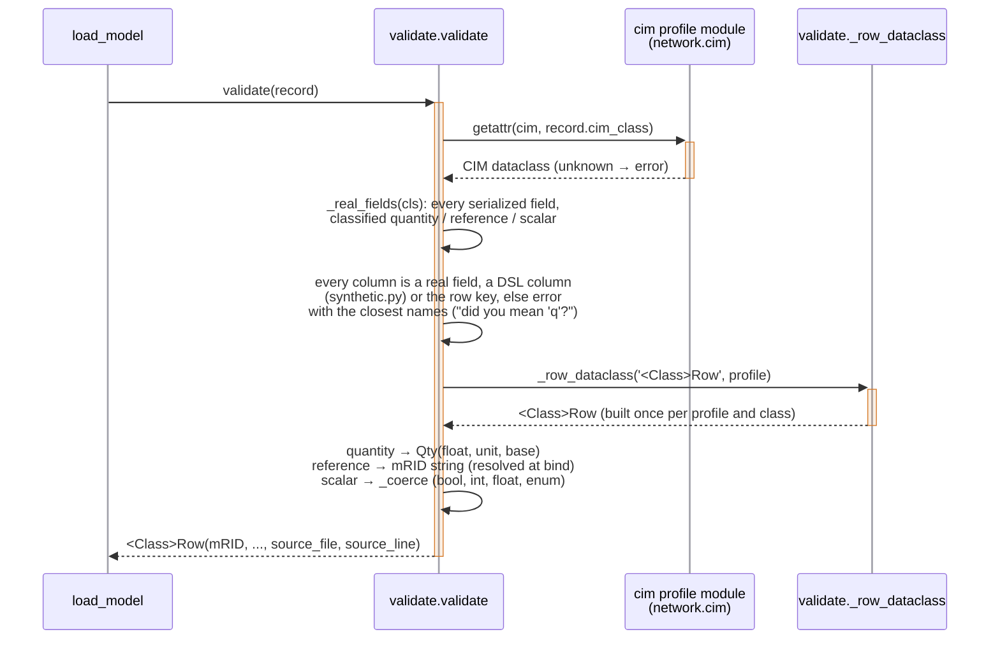
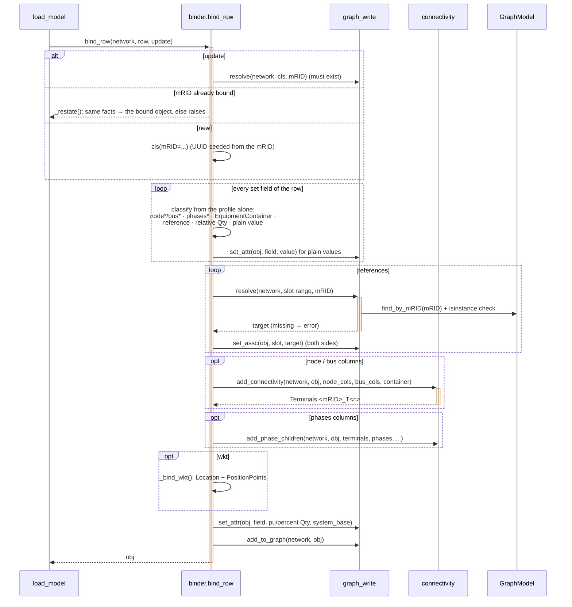
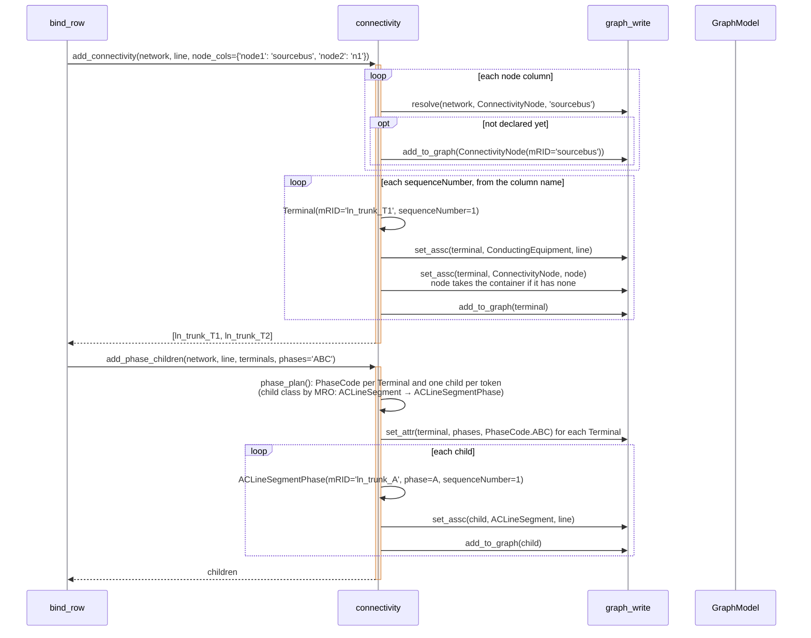

# Binding a row

A `RawRecord` becomes a live cim-graph object in two steps: `validate.validate` checks and types it against the
CIM profile without touching the graph, and `binder.bind_row` builds the object and wires it into the model.
Neither has a list of classes; both reflect on the profile module.

## `validate`: reflection on the profile

- **The row class mirrors the CIM class.** `<Class>Row` is a plain dataclass made with `make_dataclass` from the
  CIM class's own fields, plus the DSL columns from `synthetic.py`. A real CIM attribute wins over a DSL column of
  the same name: on `Terminal`, `phases` is the real `PhaseCode`, not the shorthand.
- **References stay strings.** A reference cell is only checked to be a reference slot here; whether its target
  exists is a question about the graph, answered at bind time.
- **Reflection is cached** per class (`graph_write.type_hints`, `validate._real_fields`). Classes never change
  once imported, so never mutate the cached results.

## `bind_row`

### Classifying fields

Each field the row sets goes to exactly one place, decided by the profile and `synthetic.py`, never by the class:

| Field | Goes to |
|---|---|
| `node`, `node1`, `node2`, `bus`, `bus1`, `bus2` | `connectivity.add_connectivity` |
| `phases`, `phaseSide1`, `phaseSide2`, `sequenceNumbers` | `connectivity.add_phase_children` |
| `EquipmentContainer` | resolved; also the container the Terminals' nodes take |
| any other reference slot | `graph_write.resolve` + `set_assc` |
| a `pu` / `percent` quantity | `set_attr` with the base, **after** everything else |
| anything else, `name` included | `graph_write.set_attr` |

The order inside `bind_row` is load-bearing: references before connectivity (a `TransformerEnd`'s Terminal goes
on the transformer it references), and relative impedances last (their base reads the ratings, `BaseVoltage` and
`From*` references the row just set).

### Restating an object

A formative row (`Object`/`Table`) whose mRID is already bound is a **restatement**. If its class is the same and
every cell it sets equals what is bound, `bind_row` returns the bound object and changes nothing; anything else
raises. That is what lets every feeder file declare its own `BaseVoltage`s and a catalog be imported from two
branches. `Update` rows are the only way to add to an existing object.

### Errors carry the row's location

Any `ValueError` or `TypeError` while binding a row read from a file is re-raised as `CimtblBindError`
(a subclass of both) prefixed `<file>:<line>:`, with the original as `__cause__`. A row built in code (no
`source_file`) raises the original unchanged.

## Connectivity and phases

`phase_plan` is the single synthesis rule. `add_phase_children` uses it to create children, and the writer uses
it to decide whether a model's children can be folded back into a `phases` column: if the plan for the candidate
cells reproduces exactly the children in the model, they fold. That shared rule is what keeps loading and writing
inverse to each other. The rules themselves (delta branches, split phases, `phaseSide1`/`phaseSide2`,
`sequenceNumbers`) are in the design record's [Phases](../CIMTBL_DESIGN.md#phases) section.

## `graph_write`: the one mutation point

Every change to a CIM object or to the network goes through four functions:

| Function | Does |
|---|---|
| `set_attr(obj, part, attr, value, system_base=None)` | Type-checks a scalar against the field. Turns a `Qty` into the field's `CIMUnit` in SI; a `pu`/`percent` impedance is multiplied by `impedance.z_base(obj)`. |
| `set_assc(obj, part, assc, target)` | Sets an association and its inverse side (appending to a list side without duplicates). |
| `add_to_graph(network, obj)` | Adds the object and indexes its mRID. A `BasePower` also sets `network.base_power`, and a second one that disagrees raises. |
| `resolve(network, cls, mRID)` | `find_by_mRID` plus an `isinstance` check: any subclass of the slot's class matches, another class raises. |

`get_qty(obj, attr, unit, base=None)` is `set_attr`'s read side, used by exporters: the same base rule, inverted.
Keeping every write here means units, inverse associations and the mRID index can't be forgotten at a call site.
