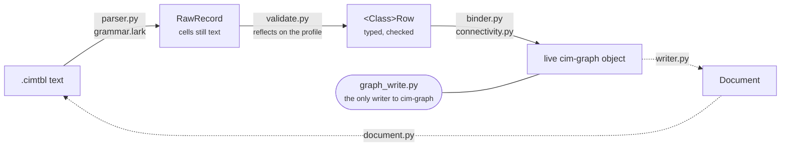

# Developer docs

How `cimtables` is built: the fixed Lark grammar, the parse → validate → bind pipeline, the one module that writes
to cim-graph, and the writer that turns a model back into text. The [design record](../CIMTBL_DESIGN.md) is the
reference for every rule and the reasoning behind it; these pages are the map.

## The pipeline



| Page | Covers |
|---|---|
| [The grammar](grammar.md) | `grammar.lark`: statements, cells, the keyword lookaheads, and how the parse tree becomes `RawRecord`s. |
| [Loading a file](loading.md) | `load_model` end to end: `Import` resolution, settings, model scope, profile, choosing the model class. |
| [Binding a row](binding.md) | `validate` and `bind_row`: reflection, field classification, connectivity and phases, relative impedances. |
| [Writing .cimtbl](writing.md) | `to_documents` and `document.py`: folding Terminals back into columns, ordering, units, formatting. |
| [Design record](../CIMTBL_DESIGN.md) | The full format and every decision, as built. |

## Modules

| Module | Role |
|---|---|
| `grammar.lark`, `parser.py` | The fixed grammar. Text → `RawRecord`s plus a `Header` of settings; resolves `Import`. |
| `records.py` | `RawRecord` (one row, cells still `str` or `None`, units, source file and line) and `ImportRecord`. |
| `validate.py` | Builds a `<Class>Row` dataclass by reflecting on the CIM profile, coerces cells, raises before any graph change. |
| `synthetic.py` | The only vocabulary that isn't CIM: the connectivity, phase and `wkt` columns. |
| `binder.py` | `bind_row`: one validated row → one live object, every field classified from the profile alone. |
| `connectivity.py` | Terminals, ConnectivityNodes and TopologicalNodes, PhaseCodes and per-phase children. |
| `graph_write.py` | `set_attr`, `set_assc`, `add_to_graph`, `resolve`, `get_qty`: the only functions that change objects or the network. |
| `impedance.py`, `units.py` | The base for pu/percent impedances; `Qty`, the carrier for a `(unit)` column. |
| `wkt.py` | The `wkt` column: WKT geometry → CIM `Location` and `PositionPoint`s. |
| `document.py` | The parser's inverse: a `Document` of cell text → deterministic `.cimtbl` text. |
| `writer.py` | `to_documents`: a cim-graph model → `Document`s that load back into an equal model. |
| `diff.py` | `diff_models`: compare two models object by object. |

## Rules that keep it simple

These are the invariants a change should not break. Each is argued in the design record's
[Load-bearing decisions](../CIMTBL_DESIGN.md#load-bearing-decisions).

- **The grammar knows no CIM.** No class or attribute name ever goes in `grammar.lark`.
- **The profile is the schema.** Validation reflects on the live profile module; there is no curated list of
  classes and no per-class dispatch in the binder.
- **Fail before mutating.** A row is fully validated before anything touches the graph, and every error carries
  `file:line`.
- **One mutation point.** Only `graph_write` calls `setattr` on a CIM object or `network.add_to_graph`.
- **A model is a function of its text.** Profile, model scope and `BasePower` all come from the file, never from an
  environment default.
- **`cimtables` never imports `cimbuilder`.** The dependency runs `cim-profiles` → `cim-graph` → `cimtables` →
  `cimbuilder`.

## Working on it

```bash
uv sync                          # cim-graph and cim-profiles resolve to ../CIM-Graph and ../CIM-Profiles
uv run pytest                    # the suite; tests target the cim18v17 profile
uv run pytest tests/test_binder.py::test_name -q
```

`pyproject.toml` points `cim-graph` and `cim-profiles` at sibling checkouts, so changes there take effect
immediately. CI installs them from PyPI instead (`--no-sources`).

Downstream projects rely on some behaviours staying put: generated names (`<mRID>_T<n>`, `<mRID>_<phase>`), error
formats, `load_model`'s model choice, the unit and base rules and `document.py`'s byte-exact layout among them. The
repository's `CLAUDE.md` lists them under "Downstream contract (CIMHub)"; flag any change to them.

## Building these docs

The site is MkDocs with the Material theme, configured in `mkdocs.yml`; the pages are in `docs/`.

```bash
uv sync --group docs
uv run mkdocs serve              # http://127.0.0.1:8000, reloads on save
uv run mkdocs build --strict     # what CI runs
```

The user guide's notebooks are stored with their outputs, and the build does not run them. After changing a
notebook or the behaviour it shows, re-run it in place:

```bash
cd docs/guide && uv run jupyter nbconvert --to notebook --execute --inplace quickstart.ipynb round_trip.ipynb
```

The theme lives in `docs/stylesheets/extra.css` and uses only Material's CSS variables, so the same file can style
the [CIM-Graph](https://pnnl-cim-tools.github.io/CIM-Graph/) docs.
