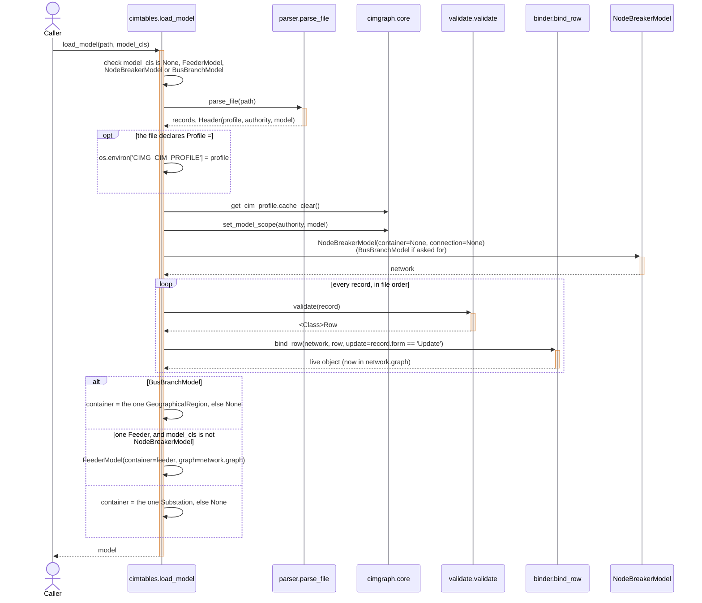
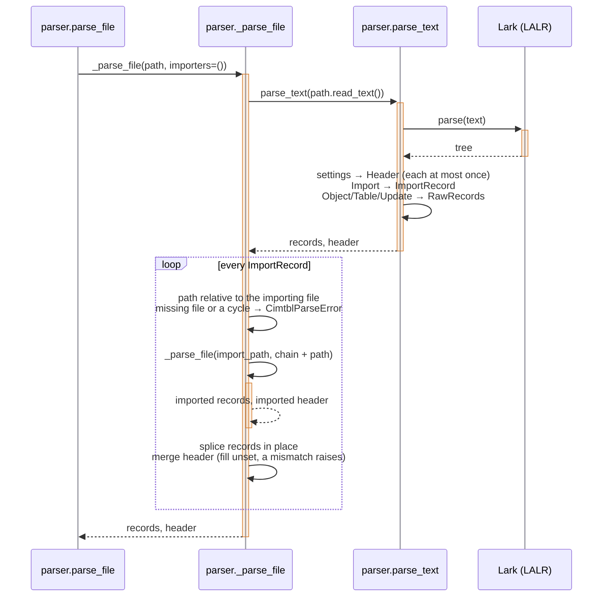
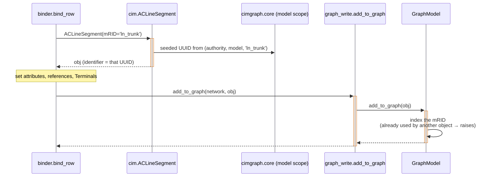

# Loading a file

`cimtables.load_model(path)` is the whole pipeline: parse the file and its imports, apply its settings, validate
and bind every row into a new in-memory cim-graph model, then choose the model class and container. It is about
twenty lines in `cimtables/__init__.py`.

## `load_model`

Three things to notice:

- **The model has no container while rows bind.** `bind_row` defaults an `EquipmentContainer` from
  `network.container`, so a container set too early would leak into equipment the file didn't put in it. The
  container is attached only after every row is bound.
- **`model_cls=FeederModel` asserts.** If the file doesn't have exactly one `Feeder`, `load_model` raises
  instead of returning another class. `NodeBreakerModel` never becomes a `FeederModel`, and Feeders are allowed in
  it (a transmission model with feeders under it).
- **Settings are process-global.** The profile is an environment variable and the model scope is cim-graph state,
  as they are everywhere in cim-graph. Tests that load files with different scopes restore them (see
  `tests/test_load_model.py`'s `model_scope` fixture).

`load(path, network)` and `load_text(text, network)` are the same loop onto a network the caller made. They
don't touch the profile: a file whose `Profile =` isn't `network.cim` raises `CimtblValidationError`, because
its rows would validate against one profile and bind with another's classes.

## `parse_file` and `Import`

`Import` is textual composition: the imported file's records are spliced in where the `Import` stood, as if its
text were pasted there. `parse_text` never reads a file; it returns each `Import` in place as an `ImportRecord`,
and `parse_file` resolves them recursively.

- **Cycles** are detected on the chain of importing files: `a` → `b` → `a` raises at the `Import` line. A file
  imported from two branches (`a` → `b` → `cat`, `a` → `c` → `cat`) is not a cycle; its rows bind twice, and the
  second time each one [restates](binding.md#restating-an-object) the object.
- **Settings merge.** An imported file's `Profile`/`Authority`/`Model` fills one the importer left unset; a
  different value raises at the `Import` line.
- **The parser applies nothing.** It only reads the settings; `load` and `load_model` apply them.

## Identity: where UUIDs come from

`bind_row` creates every object as `cim_cls(mRID=row.mRID)`. cim-graph seeds the UUID from the mRID under the
current model scope, which `load_model` has just set from `Authority =` and `Model =`:

The same file therefore gives the same UUIDs on every load, two models can each have a bus `671`, and renaming
an object (`name`) never changes its UUID. `write_xml` writes the scope into the model header and cim-graph's XML
reader restores it.
