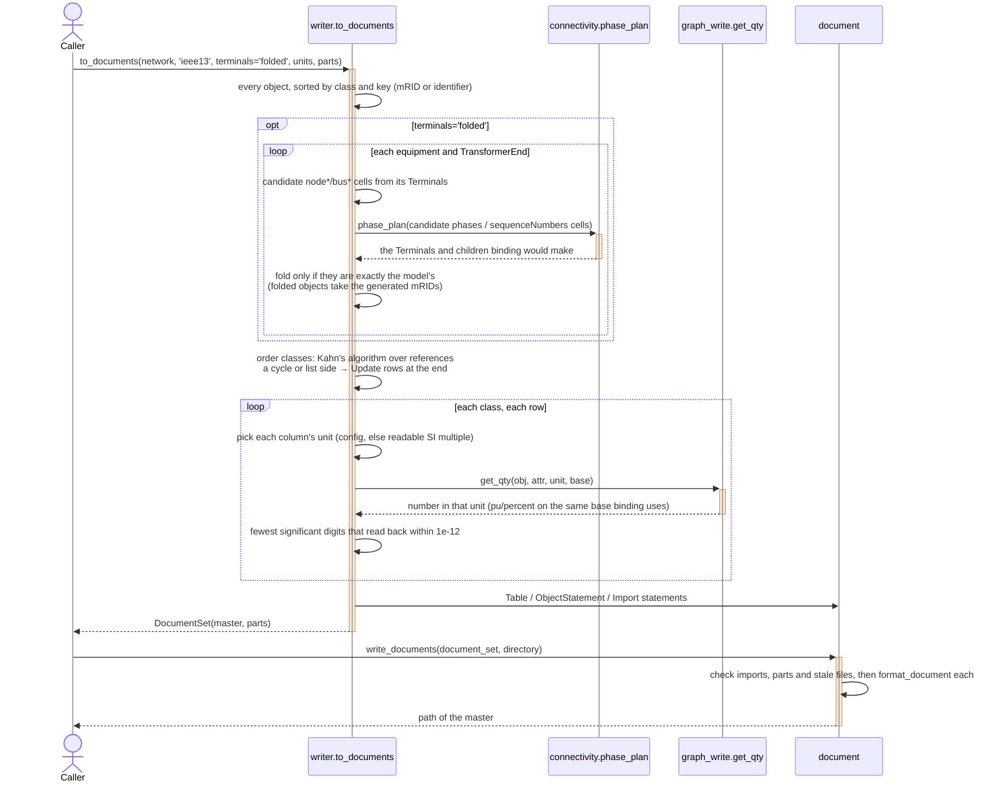

# Writing .cimtbl

Two modules go the other way, from a model to text:

- **`document.py`** is the parser's inverse: a `Document` of statements whose cells are *text* → deterministic
  `.cimtbl`. It owns layout and quoting and nothing else. Model converters (CIMHub's importers) use it directly.
- **`writer.py`** is the binder's inverse: `to_documents(network, name)` turns any cim-graph model into
  `Document`s that load back into an equal model.

## Folding

In the default `terminals='folded'` mode, an equipment's Terminals become its `node1`/`node2` (or `bus1`/`bus2`)
columns and its per-phase children its `phases` column, so the written file looks like one a person would write.
The test for whether something folds is the binder's own rule: the writer builds the candidate cells and asks
`connectivity.phase_plan` what binding them would create. Only if that is exactly what the model holds does it
fold; anything else (a Terminal with extra attributes, children numbered in a way `phases` can't express) stays
explicit.

Folded objects are renamed to the names binding generates (`<mRID>_T<n>`, `<mRID>_<phase>`), so their UUIDs
change, and references to them follow. Their other attributes go into `Update` rows. `terminals='explicit'` keeps
every Terminal and per-phase child as its own row with its original mRID.

## Ordering

References must point backwards in a `.cimtbl` file, so classes are ordered with Kahn's algorithm over the
single-valued references that only one side can write, ties broken by class name, and rows by key. What still
points forward is written as `Update` rows at the end of the master, after every object exists: a reference
cycle, a reference to a later row of the same class, and list-valued associations. Of a one-to-one association
whose sides are both serialized, only the later object's side is written.

`parts={'catalog': ['WireInfo', ...]}` moves classes into their own files, which the master imports in order.
Parts that reference each other raise, since an `Import` can't be both before and after another.

## Units and numbers

A column's unit is the configured one (`units={'Class.attr' or 'attr': unit}`, matched along the class's MRO,
`pu`/`percent` and `pu system` included), else SI or the readable multiple (kV, kW, MW, ohm/km, ...) that puts the
column's median in [1, 1000). Values are read through `graph_write.get_qty`, the mirror of `set_attr`, so a
relative unit uses the same base binding would. Quantities are written with the fewest significant digits that
read back within 1e-12 (`13.2`, not `13.200000000000001`).

## Layout (`document.py`)

`format_document` is deterministic: settings first, then statements in order with one blank line between them;
table rows indented four spaces and each cell but the last padded after its comma so columns line up. A cell is
quoted only if it must be (`,` `(` `)` `#` `"`, edge whitespace, the empty string, or text that starts like a
statement). Downstream projects diff this output byte for byte, so a layout change is a contract change.

## Testing the inverse

The writer's correctness criterion is semantic, not textual: `load_model(written)` compared with the original by
`diff_models` must be empty. Byte-identical output to a hand-written file is not a goal. `tests/test_writer.py`
checks this for both modes, and `tests/test_document.py` checks `parse_text(format_document(doc))` round trips.
