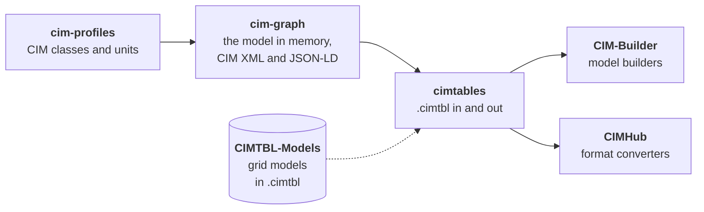

<div class="ct-hero" markdown>

# A CIM model you can write <span class="ct-accent">in Notepad</span>

<p class="ct-lede"><code>.cimtbl</code> is a plain-text table format for IEC CIM power-system models. Every table is a
CIM class, every column a CIM attribute, every row one CIM object. <code>cimtables</code> loads it into
<a href="https://github.com/PNNL-CIM-Tools/CIM-Graph">cim-graph</a>, ready to save as CIM RDF/XML or JSON-LD.</p>

[Quick start](guide/quickstart.ipynb){ .md-button .md-button--primary }
[Read the format](guide/format.md){ .md-button }
[Developer docs](developer/index.md){ .md-button }

</div>

```text title="tiny_feeder.cimtbl"
--8<-- "guide/tiny_feeder.cimtbl"
```

```python
import cimtables
from cimgraph.utils import write_xml

network = cimtables.load_model('tiny_feeder.cimtbl')  # a cim-graph FeederModel
write_xml(network, 'tiny_feeder.xml')                 # standard CIM RDF/XML
```

The loader makes what CIM requires but nobody wants to type: the `Terminal`s, the `ConnectivityNode`s they
meet at, each line's and load's per-phase objects and every Terminal's `PhaseCode`. You wrote feet and
kilowatts; the model holds SI, as CIM does.

<div class="grid cards" markdown>

-   :material-table-check:{ .lg .middle } __The profile is the schema__

    ---

    No list of supported classes. Any class, attribute or enumeration in the CIM profile can be written, and
    nothing else gets in.

    [:octicons-arrow-right-24: The format](guide/format.md)

-   :material-ray-start-arrow:{ .lg .middle } __Shorthand that expands to normative CIM__

    ---

    `node1`, `node2` and `phases` columns generate Terminals, nodes and per-phase objects by the CIM rules,
    delta loads included.

    [:octicons-arrow-right-24: Connectivity and phases](guide/connectivity.md)

-   :material-ruler:{ .lg .middle } __Units on the header__

    ---

    `length (ft)`, `p (kW)`, `x (pu)`. Values are converted once, to CIM's SI types; `pu` and `percent` use the
    equipment's own rating or the model's `BasePower`.

    [:octicons-arrow-right-24: Units and impedance bases](guide/units.md)

-   :material-map-marker-alert:{ .lg .middle } __Errors at the line__

    ---

    Each row is checked against the profile before it touches the model. Every error names the file and line,
    and nothing is skipped or guessed.

    [:octicons-arrow-right-24: When something is wrong](guide/errors.md)

-   :material-swap-horizontal:{ .lg .middle } __Both directions__

    ---

    `to_documents` writes any cim-graph model, one read from CIM XML for example, back out as `.cimtbl` that
    loads into an equal model.

    [:octicons-arrow-right-24: CIM XML to .cimtbl](guide/round_trip.ipynb)

-   :material-source-branch:{ .lg .middle } __Built for review__

    ---

    Read it top to bottom, diff it in git, review it in a pull request, ask an LLM to edit it. The same text
    always gives the same model, UUIDs included.

    [:octicons-arrow-right-24: Python API](guide/python-api.md)

</div>

## Where it fits



Larger examples, including several versions of the IEEE 13-bus feeder, are in
[CIMTBL-Models](https://github.com/PNNL-CIM-Tools/CIMTBL-Models).
